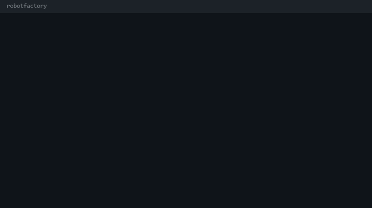

# robotfactory



Epitech project (B-CPE-200). An assembler for the Corewar virtual machine, written in C. It translates a champion written in assembly (`.s`) into the bytecode (`.cor`) that the virtual machine runs.

## Build

```
make
```

## Usage

```
./asm file_name.s
```

The output is written next to the source as `file_name.cor`. Invalid file names, empty files and label or instruction errors are reported on standard error.

## Tests

`champion_tests` holds sample champions (`.s`) with their expected bytecode (`.cor`).
